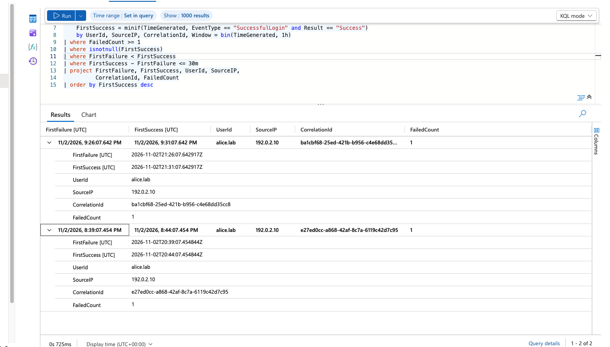
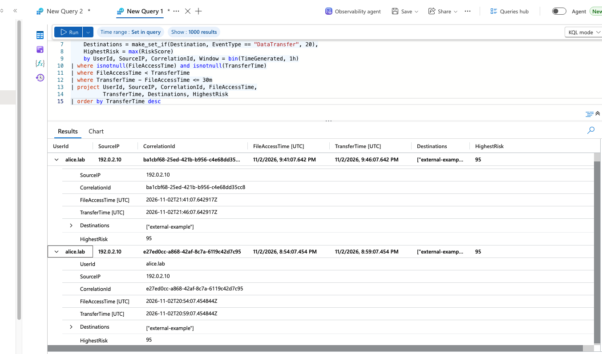
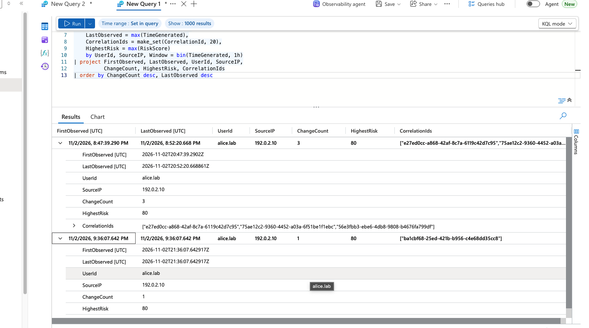
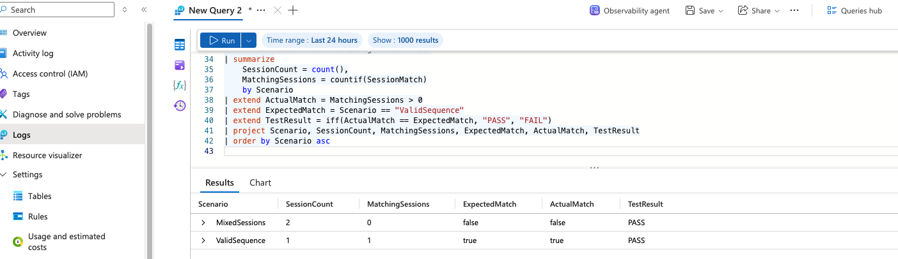
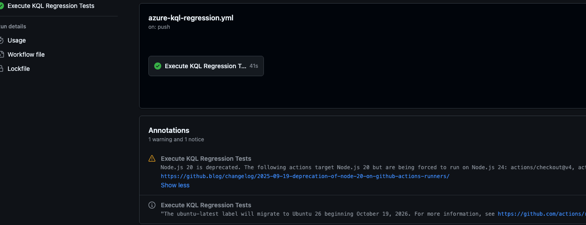

# SOC Lab Screenshot Evidence

These are authentic screenshots supplied during the lab session, copied without altering the underlying results.

## Threat hunting execution

### HUNT-001 — Authentication

### HUNT-002 — Sensitive file access followed by transfer

### HUNT-003 — Privilege changes

## Detection validation

## CI workflow

All threat-hunting matches are investigation candidates observed in lab telemetry, not confirmed incidents. The CI screenshot shows the Azure KQL regression job successful at the time captured, with a Node.js version warning.
