# Microsoft Sentinel SOC & Cloud Detection Engineering Lab

A hands-on Azure security operations project demonstrating cloud security monitoring, KQL detection engineering, alert validation, and incident response using Microsoft Sentinel and Microsoft Defender.

## Project Overview

This lab implements an end-to-end security detection workflow:

Azure Activity Logs → Log Analytics → Microsoft Sentinel → KQL Detection → Security Alert → Incident Investigation

## Technologies

- Microsoft Azure
- Microsoft Sentinel
- Microsoft Defender
- Azure Activity Logs
- Log Analytics
- Kusto Query Language (KQL)
- Azure RBAC
- Azure Policy
- Git and GitHub

## Detection Engineering

### SOC-LAB-001 — High Impact Azure Resource Deletion

**Severity:** Medium

Detects successful deletion of selected Azure resources, including virtual machines, storage accounts, network security groups, and Key Vault vaults.

**Validation:** Live alert and incident successfully tested.

An isolated network security group was intentionally deleted during an authorized security test.

Results:
- Azure Activity recorded the deletion.
- Microsoft Sentinel generated an alert.
- The incident was investigated.
- The incident was resolved as authorized security testing.
- The detection rule was disabled after validation.

[View KQL Detection](detections/SOC-LAB-001-resource-deletion.kql)

### SOC-LAB-002 — Azure RBAC Role Assignment Monitoring

**Severity:** Low

Monitors successful Azure RBAC role-assignment operations.

Results:
- Synthetic KQL testing completed successfully.
- Real Azure Activity logs queried.
- Scheduled analytics rule created.
- Rule remains disabled.
- Live alert generation has not been validated.

This detection monitors role-assignment changes generally; it does not currently distinguish privileged assignments from standard assignments.

[View KQL Detection](detections/SOC-LAB-002-rbac-monitoring.kql)

## Architecture

[View Security Architecture Diagram](docs/architecture.md)

## Security Controls

- Dedicated Azure resource group
- Monthly budget alerts
- Log Analytics daily ingestion cap
- Controlled testing of disposable resources
- No automatic remediation
- Detection rules disabled after testing or development

Budget alerts and ingestion caps do not guarantee a maximum Azure bill.

## Key Learning Outcomes

- Azure cloud security monitoring
- SIEM implementation
- KQL detection development
- Security alert investigation
- Azure RBAC activity analysis
- Microsoft Sentinel analytics rule configuration
- Incident classification and resolution

## Validation Limitations

SOC-LAB-001 was validated using one authorized real-world lab event. SOC-LAB-002 passed synthetic query testing but was not validated through live alert generation.

These detections are educational implementations and require additional tuning before production use.

## Disclaimer

This project was developed in an authorized personal security lab. Sensitive credentials, subscription identifiers, and private information are excluded from the public repository.

## Detection Evidence — Microsoft Sentinel

### SOC-LAB-001: Successful Azure Resource Deletion Detection

The following screenshot demonstrates a real Microsoft Sentinel alert generated during an authorized security test.

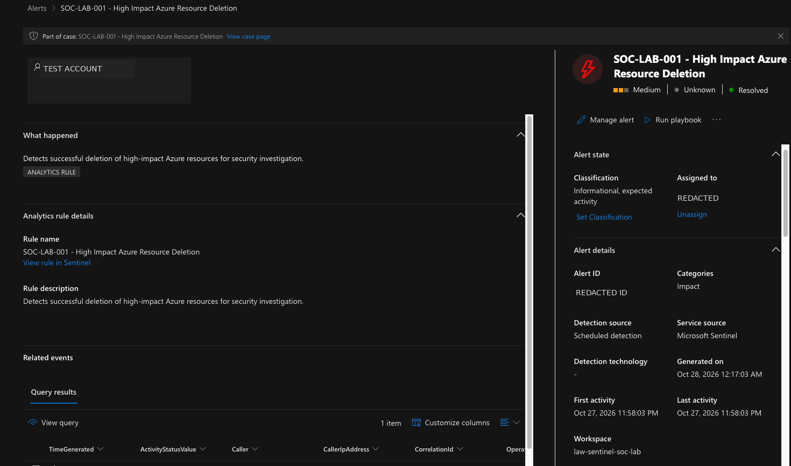

### Incident Investigation and Resolution

The resulting case was investigated and closed as authorized security testing.

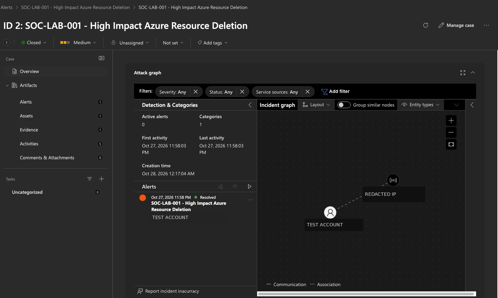

**Validation outcome:** Azure Activity successfully recorded the controlled resource deletion, the scheduled KQL analytics rule generated an alert, and the associated incident was investigated and resolved.

**Note:** Screenshots have been redacted to protect personal identifiers and security-related information.

## Detection-as-Code CI Evidence

This lab includes an automated Detection-as-Code validation pipeline using Python and GitHub Actions.

### Implemented controls

- Version-controlled JSON definitions for SOC-LAB-001 and SOC-LAB-002.
- Validation of required fields, severity, KQL source consistency, and entity mappings.
- Disabled-by-default policy for detection definitions.
- GitHub Actions validation on pushes and pull requests.
- Protected main branch requiring successful detection validation.

### Security gate validation

An intentionally invalid severity was committed to a test branch. GitHub Actions rejected the rule, and the required status check blocked the pull request from merging.

After restoring the valid severity, the pipeline passed and the merge became available.

**Failed validation and blocked merge:**

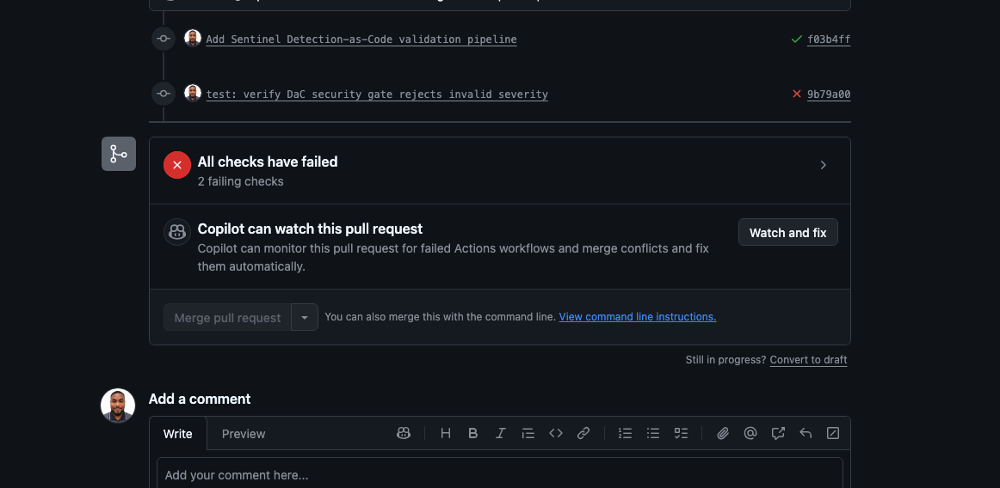

**Successful validation after remediation:**

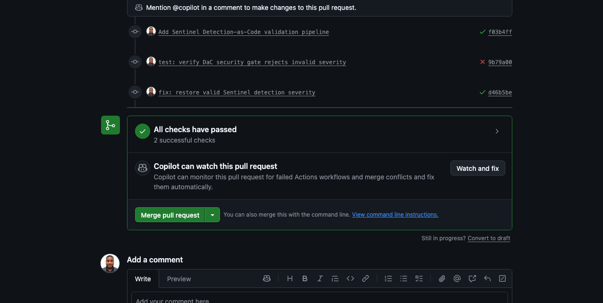

### Scope and limitations

These are local Detection-as-Code rule definitions, not yet complete deployable Microsoft Sentinel ARM templates.

The CI pipeline performs offline validation. It does not deploy analytics rules to Azure or verify live Sentinel alert generation.

The original Sentinel detection evidence remains documented separately.

## Operations and validation documentation

- [Architecture](docs/project-architecture.md)
- [Operations runbook](docs/operations-runbook.md)
- [Security review](docs/security-review.md)
- [SOC-LAB-003 correlation findings](docs/SOC-LAB-003-correlation-validation.md)

The lab includes static validation and an Azure-authenticated
KQL regression workflow covering nine synthetic scenarios.

The custom analytics rules remain disabled.
The session-aware candidate has not been deployed.

## Threat Hunting and MITRE ATT&CK — v1.1

Three read-only hunting queries operate on SOCSecurityEvents_CL:

- [HUNT-001: Authentication](hunts/HUNT-001-authentication.kql)
- [HUNT-002: Data Transfer](hunts/HUNT-002-data-transfer.kql)
- [HUNT-003: Privilege Changes](hunts/HUNT-003-privilege-changes.kql)

### Evidence and investigation
- [Hunting playbook](docs/threat-hunting-playbook.md)
- [MITRE ATT&CK coverage](docs/mitre-attack-coverage.md)
- [Azure execution results](docs/threat-hunting-results.md)

All three hunts executed successfully against Azure Log Analytics.
Six matching rows were returned; none is a confirmed incident.

## Threat Hunting and Detection Engineering — Evidence Gallery

Evidence from Azure Log Analytics and GitHub Actions.
Matching events are lab investigation candidates, not confirmed attacks.

### HUNT-001 — Suspicious Authentication

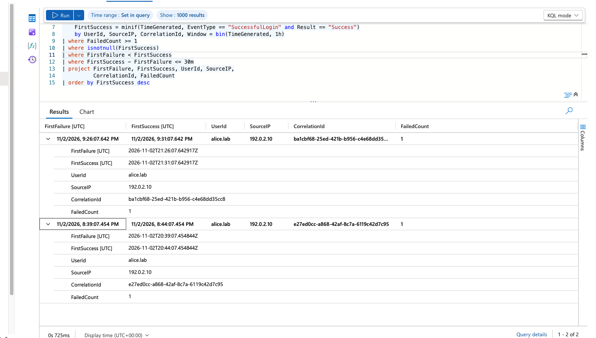

### HUNT-002 — Potential Data Exfiltration

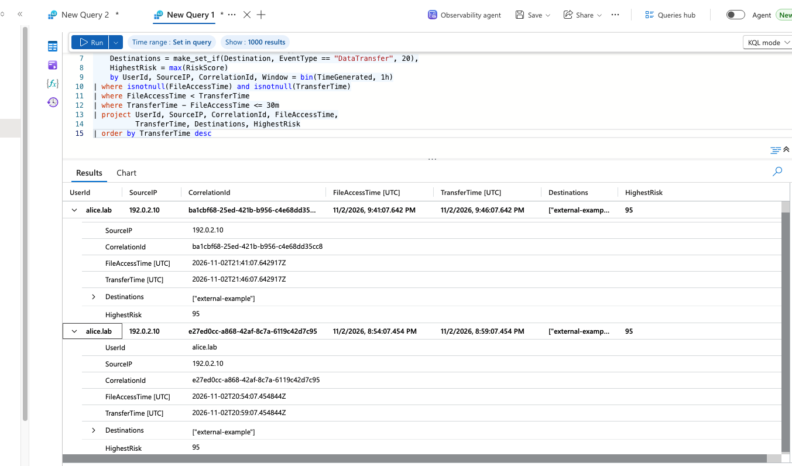

### HUNT-003 — Privilege Change Investigation

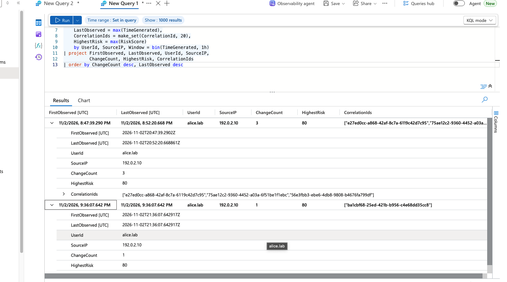

### SOC-LAB-003 — Session-Aware Validation

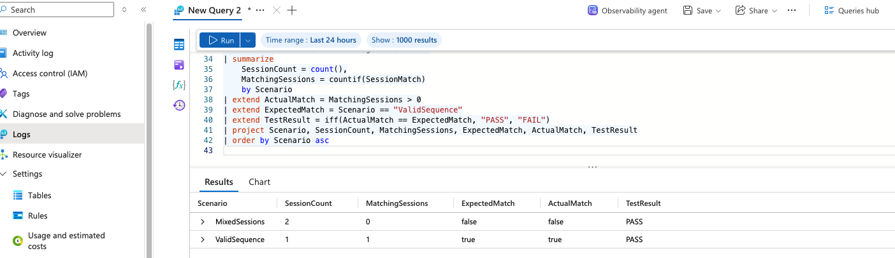

### GitHub Actions — Automated KQL Regression

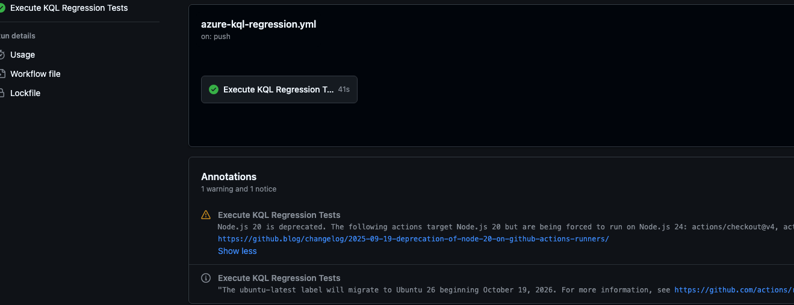

---

## Threat-Informed Detection & Adversary Validation

This repository includes an adversary-validation module that tests
security telemetry visibility against controlled MITRE ATT&CK scenarios.

### ADV-001 — PowerShell Execution Telemetry Validation

**MITRE ATT&CK:** T1059.001 — PowerShell

ADV-001 demonstrates the end-to-end processing of a genuine Windows
Security Event ID 4688 from an authorized Windows 11 lab endpoint.

**Validated workflow:**

1. Execute a benign PowerShell process on Windows 11.
2. Capture Windows Security Event ID 4688.
3. Export the original endpoint telemetry.
4. Transform the evidence into the existing Azure DCR schema.
5. Submit the record using the Azure Monitor Logs Ingestion API.
6. Verify the record in Log Analytics using KQL.
7. Execute positive and negative detection-validation tests.
8. Validate Python detection logic through GitHub Actions.

### Verified Results

| Validation | Result |
|---|---|
| Windows Security Event ID 4688 | Captured |
| Azure Monitor ingestion | HTTP 204 |
| Sentinel KQL event retrieval | 1 matching record |
| Positive KQL validation | PASS |
| Negative KQL validation | PASS |
| Python unit tests | 6/6 passed |
| GitHub Actions CI | Passed |

### Evidence

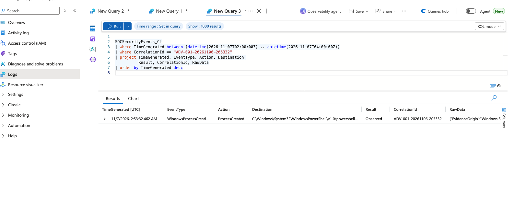

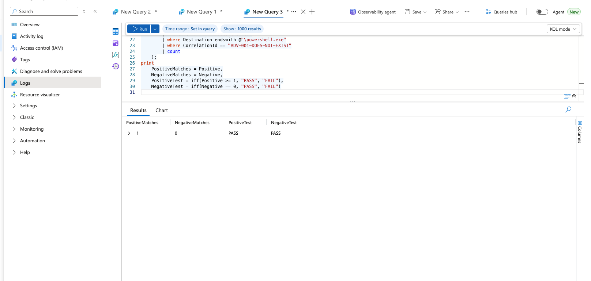

### Technical Documentation

- [ADV-001 validation report](adversary-validation/reports/ADV-001-validation-report.md)
- [ADV-001 scenario specification](adversary-validation/scenarios/ADV-001-powershell.md)
- [Sentinel KQL validation](adversary-validation/detections/ADV-001-sentinel.kql)
- [Python detection logic](adversary-validation/detections/adv001_detector.py)
- [Automated tests](adversary-validation/tests/test_adv001.py)

**Scope and limitations:** The simulation was executed interactively
because the endpoint's PowerShell execution policy blocked the saved
script. Telemetry was forwarded manually through the Logs Ingestion API.
The current detector matches a controlled test identifier; it is not
a general-purpose malicious PowerShell detector. Continuous endpoint
collection and Sentinel incident generation were not implemented.
