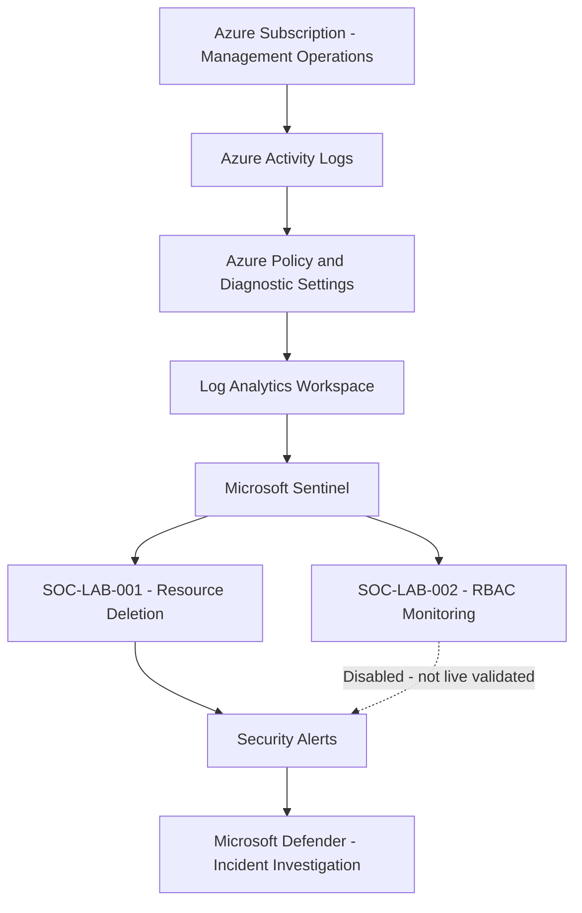

# Microsoft Sentinel SOC Lab — Architecture

## Security Monitoring Architecture

## Detection Status

| Detection | Status |
|---|---|
| SOC-LAB-001 | Live alert and incident validated; disabled |
| SOC-LAB-002 | KQL tested; rule created but disabled |

## AWS Service Comparisons

| Azure Service | AWS Equivalent |
|---|---|
| Azure Activity Logs | AWS CloudTrail |
| Log Analytics | Amazon CloudWatch Logs |
| Microsoft Sentinel | SIEM and security operations capabilities |
| KQL | CloudWatch Logs Insights query language |
| Azure Policy | AWS Config and governance policies |
| Azure RBAC | AWS IAM access management |

These are functional comparisons, not identical services.

## Security Controls

- Subscription-level activity monitoring
- Dedicated Azure resource group
- Log Analytics daily ingestion cap
- Monthly budget alerts
- Controlled detection testing
- Authorized incident resolution
- No automated remediation

## Validation

Azure Activity → Log Analytics → Sentinel Detection → Alert → Incident → Resolution

SOC-LAB-001 was validated through the authorized deletion of an isolated test network security group.
